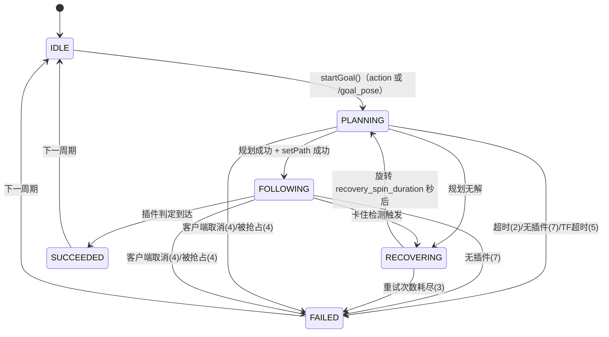
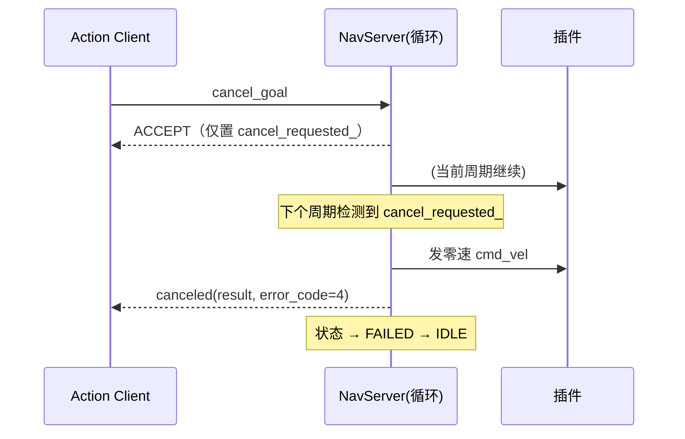
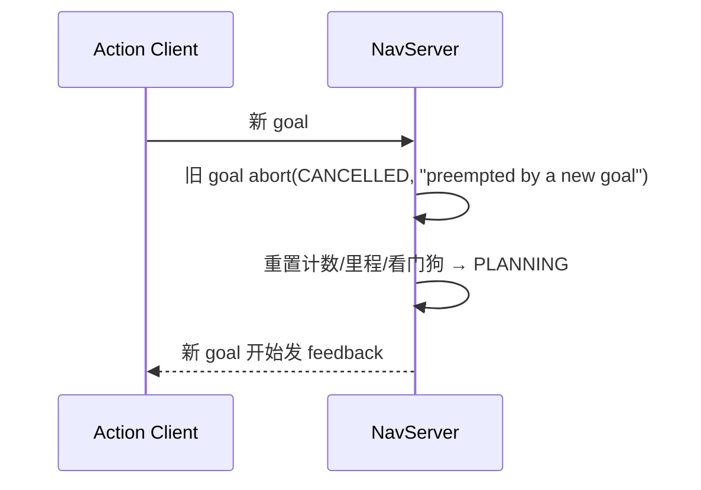

# NavServer 设计与契约

> 最后核对：commit `4c0cad3`（2026-10-23）
> 读者：想改框架的人 / 想接插件的人 / 想评审设计的人
> 代码：`src/pnc_nav_core/include/pnc_nav_core/nav_server.hpp`、`src/pnc_nav_core/src/nav_server.cpp`

---

## 1. 一句话职责

**NavServer 是"一次导航会话"的唯一管理者**：收目标 → 调全局规划插件 → 交给局部规划/跟踪插件 → 输出 `cmd_vel` → 判定成功/失败/取消，并对外提供 feedback 与错误码。

它**不做**的事（刻意留白，保持小而可懂）：定位、建图、行为树、任务调度、步态控制。

```
          ┌──────────────┐   goal_pose (兼容入口)   ┌──────────────────────────┐
          │   RViz/脚本   │ ───────────────────────▶ │                          │
          │  action client│ ◀── feedback / result ── │        NavServer         │
          └──────────────┘   navigate_to_3d_pose    │  ┌────────────────────┐  │
                                                     │  │ 状态机（单会话）    │  │
          ┌──────────────┐        /map (OccupancyGrid)│  └────────────────────┘  │
          │  map_server  │ ───────────────────────▶ │  ┌────────────────────┐  │
          └──────────────┘                           │  │ Nav2CostmapAdapter │  │
                                                     │  └────────────────────┘  │
          ┌──────────────┐   TF: map→base_link       │  ┌────────────────────┐  │
          │ Gazebo/真机  │ ───────────────────────▶ │  │ GlobalPlanner 插件 │  │
          │  /odom /tf   │ ◀── /cmd_vel ─────────── │  │ LocalPlanner 插件  │  │
          └──────────────┘                           │  │ PathTracker  插件  │  │
                                                     │  └────────────────────┘  │
                                                     └──────────────────────────┘
```

---

## 2. 节点接口

### 2.1 订阅

| 话题 | 类型 | 作用 | 备注 |
|---|---|---|---|
| `goal_pose` | `geometry_msgs/msg/PoseStamped` | **兼容入口**：等价于发一个不带 `planner_id` 的 action goal | 无 feedback/result |
| `odom` | `nav_msgs/msg/Odometry` | 只取 `twist.twist` 作为"当前速度"喂给局部插件 | 位姿仍以 TF 为准 |

### 2.2 发布

| 话题 | 类型 | 频率 | 作用 |
|---|---|---|---|
| `global_plan` | `nav_msgs/msg/Path` | 每次规划成功时 | 全局路径（RViz 可视化 / 评估脚本） |
| `local_plan` | `nav_msgs/msg/Path` | 跟随中每周期（插件提供时） | 局部轨迹 |
| `cmd_vel` | `geometry_msgs/msg/Twist` | 跟随中每周期；退出时发一次零速 | 运动指令 |
| `costmap` | `nav_msgs/msg/OccupancyGrid` | 每 10 个控制周期（20Hz → 2Hz） | **局部滚动窗口**（8m，静态+激光+膨胀） |
| `obstacle_layer` | `nav_msgs/msg/OccupancyGrid` | 同上 | 仅激光障碍的窗口（调试/教学） |

### 2.3 Action（主入口）

- 名字：`navigate_to_3d_pose`
- 类型：`pnc_nav_interfaces/action/NavigateTo3DPose`

**Goal**

| 字段 | 类型 | 语义 |
|---|---|---|
| `goal` | `PoseStamped` | 目标位姿；`frame_id` 为空时按参数 `global_frame`（默认 `map`）处理 |
| `planner_id` | `string` | 非空时在执行前**热插拔**全局规划器（如 `pnc_nav_planners::AStar2D`）；空 = 用参数里的默认插件 |
| `max_planning_time` | `float64` | 单次规划时间上限（秒），0 = 不限；超时 → `error_code=2` |

**Feedback**（跟随/规划/恢复期间持续发布）

| 字段 | 语义 |
|---|---|
| `current_pose` | 当前位姿（TF `map → base_link`） |
| `distance_remaining` | **到目标点的直线距离**（不是剩余路径长度，见 §8 已知限制） |
| `eta_seconds` | `distance_remaining / feedback_eta_speed`（默认按 0.25 m/s 估算） |
| `number_of_recoveries` | 本会话已进入恢复行为的次数 |
| `current_state` | `planning` / `following` / `recovering`（小写） |

**Result**

| 字段 | 语义 |
|---|---|
| `success` | `error_code == 0` |
| `error_code` | 见 §6 错误码矩阵 |
| `total_time` | 从会话开始到结束的墙钟时间（秒） |
| `distance_traveled` | 跟随阶段累计位移（对位姿差分累加，不含恢复旋转） |
| `message` | 人类可读描述（含失败原因，便于日志检索） |

### 2.4 TF

| 查询 | 用途 | 频率 |
|---|---|---|
| `lookupTransform(global_frame, robot_frame, TimePointZero)` | 当前位姿 | 每个控制周期（20Hz） |

- 默认 `global_frame=map`、`robot_frame=base_link`（参数可改）
- 连续拿不到 TF 超过 `tf_timeout_ticks`（默认 50 个周期 ≈ 2.5s）→ 会话以 `error_code=5` 结束，避免"卡在 planning 不动"。

---

## 3. 状态机



### 3.1 状态定义

| 状态 | 含义 | 每个控制周期做什么 |
|---|---|---|
| `IDLE` | 空闲，无会话 | 什么都不做（仅可视化 costmap） |
| `PLANNING` | 正在算全局路径 | 取位姿 → 调 `createPlan()` → 成功则 `setPath()` 并转 `FOLLOWING`；失败则 `RECOVERING` |
| `FOLLOWING` | 正在跟踪 | 取位姿 → 卡住检测 → 调插件 `computeVelocityCommand()` → 发 `cmd_vel` → 判到达 |
| `RECOVERING` | 最小恢复 | 原地旋转（1s），然后回 `PLANNING` |
| `SUCCEEDED` / `FAILED` | 终态（仅 1 个周期，用于日志） | 下一周期回 `IDLE` |

### 3.2 迁移表（状态 × 事件 → 动作）

| 当前状态 | 事件 | 新状态 | 动作 / 副作用 |
|---|---|---|---|
| 任意 | 收到新 goal | `PLANNING` | 旧会话以 `CANCELLED` 结束（抢占）；重置计数/里程/看门狗 |
| `PLANNING` | `createPlan()` 返回空路径 | `RECOVERING` | `recovery_count++`；超上限则 `MAX_RETRIES` |
| `PLANNING` | 规划成功 | `FOLLOWING` | 发布 `global_plan`；`setPath()`；重置进度看门狗 |
| `PLANNING` | 规划耗时 > `max_planning_time` | `FAILED` | `error_code=2` |
| `PLANNING`/`FOLLOWING` | TF 连续失败 > `tf_timeout_ticks` | `FAILED` | `error_code=5` |
| `FOLLOWING` | 插件 `isGoalReached`/`isPathCompleted` 为真 | `SUCCEEDED` | 发零速；`error_code=0` |
| `FOLLOWING` | `progress_timeout` 内位移 < `progress_epsilon` | `RECOVERING` | `recovery_count++`（原因记为 stuck） |
| `RECOVERING` | 旋转满 `recovery_spin_duration` | `PLANNING` | 重置 `plan_start_time` |
| 任意（有会话） | 客户端 cancel | `FAILED` | 先发零速，再 `canceled(result)`（`error_code=4`） |
| 任意（有会话） | 没有可用的全局/局部插件 | `FAILED` | `error_code=7` |

---

## 4. 一个控制周期做了什么

`nav_server_node.cpp` 使用 **单线程执行器**（`rclcpp::spin`），所有回调串行，因此代码里**没有锁**。

```
每个周期（默认 20Hz，wall timer）：
1. 每 10 周期发布一次 /costmap
2. cancel_requested_ ?  → 停车 + 回 cancel result + 结束
3. TF 连续失败超限 ?    → error_code=5 结束
4. switch(state_)
   ├ IDLE: 空转
   ├ PLANNING: 位姿 → 规划 → 成功: 发布路径 + setPath + 转 FOLLOWING
   │                       └ 失败: RECOVERING（次数超限则 MAX_RETRIES）
   ├ FOLLOWING: 位姿 → 里程累计 → 卡住检测 → 插件算速度 → 判到达
   │            └ 到达: 零速 + SUCCEEDED（error_code=0）
   ├ RECOVERING: 旋转中 → 转 PLANNING
   └ SUCCEEDED/FAILED: 打日志 → IDLE
```

> ⚠️ 全局规划**只在进入 `PLANNING` 时算一次**；`FOLLOWING` 期间不会周期性重规划（见 §8）。

---

## 5. 恢复行为（RECOVERING）

| 项 | 值 / 说明 |
|---|---|
| 触发条件 | ① 全局规划无解；② `progress_timeout`（默认 8s）内位移小于 `progress_epsilon`（默认 0.05m） |
| 动作 | 原地旋转 `recovery_spin_duration`（默认 1s，`recovery_angular_vel` 0.6 rad/s）后重新规划 |
| 重试上限 | `max_planning_retries`（默认 3）：进入恢复 3 次后仍在失败 → `error_code=3`（MAX_RETRIES） |
| 计数用途 | `number_of_recoveries` feedback 字段；日志 `Entering recovery (...) attempt N/3` |
| 未实现（下一轮） | 清局部代价地图（等 obstacle layer 加入后才有意义）、后退、按失败原因区分策略 |

设计动因：先保证**有出口**——早期版本 `RECOVERING` 只打日志就转 `FAILED`，重试参数形同虚设；现在把它做成"可观测、可计数、有上限"的最小闭环。

---

## 6. 错误码矩阵

| code | 枚举 | 触发条件 | message 示例 |
|---|---|---|---|
| 0 | `OK` | 插件判定到达 | `goal reached` |
| 1 | `NO_PATH` | 局部插件 `setPath()` 拒绝路径 | `local planner rejected the path` |
| 2 | `PLANNING_TIMEOUT` | 单次规划超过 `max_planning_time` | `planning exceeded 5.000000 s` |
| 3 | `MAX_RETRIES` | 恢复次数用尽 | `recovery attempts exhausted after 4 tries (last: planning failed)` |
| 4 | `CANCELLED` | 客户端取消 / 被新目标抢占 | `goal cancelled by client` / `preempted by a new goal` |
| 5 | `TF_FAILURE` | 连续 `tf_timeout_ticks` 个周期拿不到 `map→base_link` | `TF unavailable, check map->odom->base_link` |
| 6 | `INVALID_GOAL` | 目标含非有限数值，或 `planner_id` 加载失败 | `failed to start goal (invalid pose or planner_id)` |
| 7 | `NO_PLANNER` | 全局/局部/跟踪插件未加载 | `no global planner loaded` |

---

## 7. 取消与抢占时序

设计原则：**先把车停稳，再回 result**。因此 `handle_cancel` 只置标记并返回 `ACCEPT`，真正停车与 `canceled()` 都发生在控制循环里；被抢占时旧 goal 直接以 `CANCELLED` 结束（`abort` 而非 `canceled`，message 标注 `preempted`）。



抢占（新目标到达）：



兼容入口 `/goal_pose` 走同一条 `startGoal()`，但没有 `goal_handle`，因此**不会产生 feedback/result**，只写日志。

---

## 8. 时钟、线程与已知限制

**时钟**
- 消息时间戳用节点时钟（仿真下 `use_sim_time=true`）
- 超时判断全部用 `std::chrono::steady_clock`，**不受 sim time 跳变/回退影响**

**线程**
- `rclcpp::spin` 单线程，action/timer/subscription 串行执行 → 无锁；如果将来改 `MultiThreadedExecutor`，必须重新审一遍会话状态。

**已知限制（按影响排序）**

1. **到达判定由插件决定**：`PurePursuit2D` 用"到路径末点距离"，`DWA2D` 用"距离+角度"，而 feedback 的 `distance_remaining` 是"到目标点直线距离"——会出现 `dist=0.20` 却已成功的情况（见 `notes/known_issues.md`）。
2. **不周期性重规划**：`FOLLOWING` 中只有卡住检测，没有局部避障失败后重规划（等 obstacle layer）。
3. **恢复只清激光障碍点**：进入 `RECOVERING` 会调用 `RollingCostmap::clear()`，但不清静态图（静态层本就无状态）。
4. **单会话模型**：不支持目标队列；新目标抢占旧目标。
5. **无任务层**：没有行为树/恢复行为编排/多点导航。
6. **插件互斥**：`switchLocalPlanner()` 会 `reset` 掉 path tracker，`switchPathTracker()` 会 `reset` 掉 local planner（二选一）。
7. **无 lifecycle**：非 `rclcpp_lifecycle` 节点；插件的 `activate/deactivate` 只是可选钩子。
8. **原地旋转恢复不检查碰撞**：没有 costmap 检查，实机上需要先加安全判断。

---

## 9. 参数

| 参数 | 类型 | 默认值 | 单位 | 说明 |
|---|---|---|---|---|
| `control_frequency` | double | 20.0 | Hz | 控制循环频率 |
| `global_frame` | string | `map` | — | 全局坐标系 |
| `robot_frame` | string | `base_link` | — | 机器人本体坐标系 |
| `goal_tolerance_dist` | double | 0.15 | m | 到达判定距离容差（传给插件） |
| `goal_tolerance_angle` | double | 0.1 | rad | 到达判定角度容差（仅部分插件使用） |
| `max_planning_retries` | int | 3 | 次 | 恢复/重规划次数上限 |
| `global_planner_plugin` | string | `pnc_nav_planners::AStar3D` | — | 默认全局插件（yaml 中为 `AStar2D`） |
| `local_planner_plugin` | string | `""` | — | 非空则用局部规划器（与 tracker 二选一） |
| `path_tracker_plugin` | string | `pnc_nav_planners::PurePursuit3D` | — | 路径跟踪器（yaml 中为 `PurePursuit2D`） |
| `recovery_spin_duration` | double | 1.0 | s | 恢复时原地旋转时长 |
| `recovery_angular_vel` | double | 0.6 | rad/s | 恢复时旋转角速度 |
| `feedback_eta_speed` | double | 0.25 | m/s | 计算 ETA 的参考速度 |
| `progress_timeout` | double | 8.0 | s | 无位移多久判卡住（<=0 关闭） |
| `progress_epsilon` | double | 0.05 | m | 卡住判定的位移阈值 |
| `tf_timeout_ticks` | int | 50 | 周期 | 连续 TF 失败多少周期判失败 |

**代价地图参数**（详见 `map_and_costmap.md`）：
- `map_adapter.*`：全局静态层（`Nav2CostmapAdapter`）
- `local_costmap.*`：局部滚动层（`RollingCostmap`，含 `window_size` / `obstacle_ttl` / `max_range` / `include_static` 等）

**代价地图分层**：

| 层 | 实现 | 给谁 |
|---|---|---|
| 全局（静态整图） | `Nav2CostmapAdapter` | 全局规划器插件 |
| 局部（8m 滚动窗口 + 激光障碍） | `RollingCostmap` | 局部规划器插件 |

---

## 10. 变更记录

| 日期 | 变更 |
|---|---|
| 2026-10-23 | 初版：Action 接口、错误码、恢复行为、卡住检测、TF 超时（commit `4c0cad3`） |
| 2026-10-23 | 代价地图拆成全局静态 + 局部滚动窗口（`RollingCostmap`），新增 `/obstacle_layer`、恢复清障碍点 |
